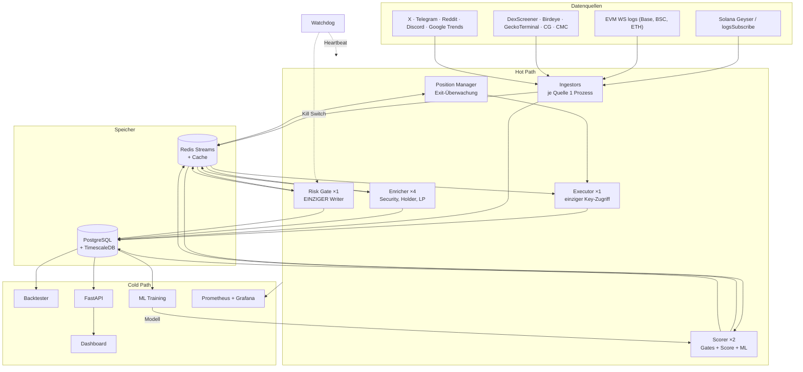
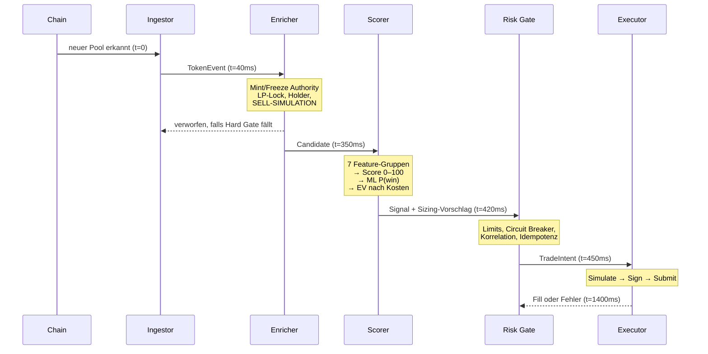
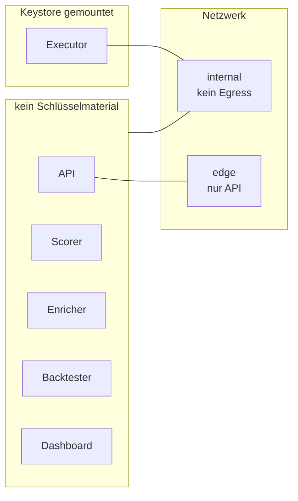
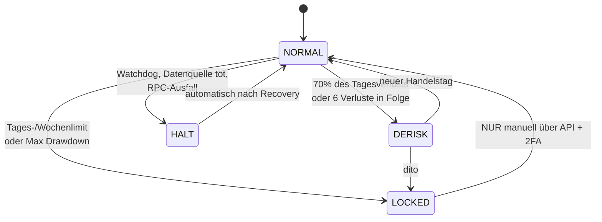

# Architektur

## 1. Leitprinzip: Hot Path vs. Cold Path

Das System zerfällt in zwei Hälften mit völlig unterschiedlichen Anforderungen:

| | Hot Path | Cold Path |
|---|---|---|
| Aufgabe | Erkennen → Filtern → Bewerten → Ausführen | Analyse, ML, Backtest, Dashboard |
| Budget | < 800 ms End-to-End | Minuten bis Stunden |
| Fehlerverhalten | Fail closed (kein Trade) | Retry, eventual consistency |
| Datenzugriff | Redis, In-Memory | PostgreSQL, Parquet |
| ORM | nein | ja |

Die häufigste Architekturfehlentscheidung in solchen Systemen ist, beides zu
vermischen: ein SQLAlchemy-`session.query()` im Signalpfad kostet 15–40 ms und
blockiert bei Connection-Pool-Erschöpfung den gesamten Loop. Deshalb liest der
Hot Path ausschließlich aus Redis und schreibt asynchron per Stream nach Postgres.

## 2. Gesamtbild



## 3. Der Entscheidungspfad eines Tokens



Die vier Sekunden zwischen Pool-Erkennung und Fill sind der Grund, warum dieses
System **kein Sniper** ist. Siehe `docs/RISKS.md`, Abschnitt „Wo der Edge nicht
liegt".

## 4. Warum Redis Streams und nicht Kafka

| Kriterium | Redis Streams | Kafka |
|---|---|---|
| Durchsatz | ~1 M msg/s (reicht 1000-fach) | höher |
| Consumer Groups | ja | ja |
| Betriebsaufwand | 1 Container | ZooKeeper/KRaft, Partitionen, Rebalancing |
| Latenz p99 | < 1 ms | 5–15 ms |
| Wird ohnehin gebraucht | ja (Cache, Locks) | nein |

Bei einem Zielvolumen von wenigen hundert Events pro Sekunde ist Kafka reine
Betriebslast ohne Gegenwert. Der Wechsel lohnt erst bei Multi-Node-Betrieb mit
Replay-Anforderungen über Wochen — dann ist die Stream-Abstraktion in
`mca.core.bus` der einzige Ort, der geändert werden muss.

## 5. Warum genau ein Risk Gate

Der Risk Gate ist **absichtlich nicht horizontal skaliert**. Mit zwei Replicas
entsteht diese Race Condition:

```
t=0ms   Worker A liest: offene Positionen = 4, Limit = 5  → erlaubt
t=1ms   Worker B liest: offene Positionen = 4, Limit = 5  → erlaubt
t=90ms  beide Fills bestätigt → 6 offene Positionen
```

Mögliche Lösungen wären ein verteilter Lock oder `SERIALIZABLE`-Transaktionen —
beides mit Kosten und subtilen Fehlermodi. Ein einzelner Prozess mit
In-Memory-State und synchronem Postgres-Write ist einfacher, schneller
(> 10 000 Entscheidungen/s) und beweisbar korrekt. Skalierungslimits sollten
dort gesetzt werden, wo Korrektheit wichtiger ist als Durchsatz.

## 6. Isolation der Signaturschlüssel



Der Executor hat **keinen eingehenden Port** — er konsumiert nur aus Redis. Die
API hat **kein Schlüsselmaterial**. Die Schnittmenge ist leer, damit ein RCE in
der HTTP-Schicht nicht zum Wallet-Zugriff führt.

Zusätzlich: Der Hot Wallet ist ein *Spending Limit*, kein Wallet. Über
`hot_wallet_max_usd` hinausgehende Gewinne werden per Cron auf eine Cold-Adresse
gesweept. Ein kompromittierter Hot Key soll einen Tagesumsatz kosten, nicht das
Konto.

## 7. Datenfluss der Zeitkorrektheit

Jedes zeitabgeleitete Feature bekommt seinen Referenzzeitpunkt als **Argument**,
nie aus der Wanduhr:

```python
# falsch — im Backtest still fehlerhaft
age = (datetime.utcnow() - token.created_at).total_seconds()

# richtig — Backtest und Live liefern identische Werte
age = token.age_seconds(as_of=candidate.as_of)
```

Genau dieser Bug wurde beim Schreiben der Tests gefunden (`test_too_young_token_is_rejected`).
Im Live-Betrieb war die Variante mit `utcnow()` korrekt; im Backtest meldete sie
jeden replayed Token als Monate alt, sodass der `min_age`-Gate nichts filterte.
Solche Fehler machen einen Backtest nicht *falsch* — sie machen ihn *optimistisch*,
was schlimmer ist.

In der Datenbank spiegelt sich dasselbe: jede Tabelle im ML-Pfad trennt `as_of`
(wann die Information galt) von `created_at` (wann wir sie erfuhren).

## 8. Modulübersicht

```
src/mca/
├── core/         Config, Logging, Bus-Abstraktion, Clock
├── domain/       Dataclasses — die gemeinsame Sprache aller Module
├── db/           Schema, Repositories, Migrationen
├── ingest/       Ein Adapter je Datenquelle, normalisiert auf TokenEvent
├── enrich/       Security-Checks, Holder-Analyse, Wallet-Labels
├── features/     Point-in-time Feature Store, Indikatoren
├── scoring/      Hard Gates, Composite Score, EV-Entscheidung
├── risk/         Sizing (AMM/Kelly/ATR), Limits, Circuit Breaker
├── execution/    Chain-Adapter, Idempotenz, Shadow-Mandate
├── portfolio/    Position Manager, Exit-Engine
├── ml/           Purged CV, Kalibrierung, Modellregistrierung
├── backtest/     Event-Replay, Fill-Modell, Metriken, Walk-Forward
├── api/          FastAPI, WebSocket-Feed
├── alerts/       Telegram, Discord, E-Mail, Push
└── ops/          Watchdog, Celery-Tasks, Health
```

Abhängigkeitsregel: `domain` importiert nichts. `scoring`, `risk` und `portfolio`
importieren nur `domain` und `features`. Nur `execution` importiert Chain-SDKs.
Dadurch ist der gesamte Entscheidungskern ohne Netzwerk, ohne Datenbank und ohne
Chain-Bibliotheken testbar — was die 45 Unit-Tests in unter zwei Sekunden
durchlaufen lässt.

## 9. Betriebszustände



`LOCKED` ist bewusst nicht automatisch reversibel. Ein Bot, der sein Tagesbudget
verloren hat, soll sich nicht selbst wieder freischalten können.
