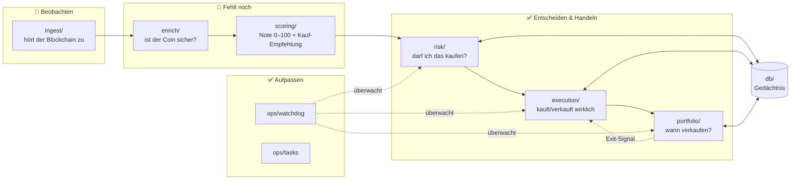

# Überblick: Was ist das hier eigentlich?

Diese Datei beantwortet zwei Fragen: **wie sieht das Ganze aus**, wenn man
einen Schritt zurücktritt, und **was tut jede Datei**, in einem Satz.

---

## "Wann packst du das als eins zusammen?" — kurze Antwort

Es ist bereits so gepackt, wie es bei einem System dieser Art überhaupt geht:
**ein Kommando** (`./start.sh`) startet **alle Programme, die zusammen laufen
müssen**. Es gibt keine Ein-Datei-Version davon — aus demselben Grund, aus dem
es bei einer Trading-Firma, einer Banking-App oder Netflix auch keine gibt:

Das System muss mehrere Dinge **gleichzeitig, dauerhaft und unabhängig
voneinander** tun — der Blockchain zuhören, während gleichzeitig eine offene
Position überwacht wird, während gleichzeitig ein Kauf ausgeführt wird. Presst
man das in eine Datei/einen Prozess, reißt ein Absturz in der Kursberechnung
den Teil mit, der gerade Geld verwaltet. Die Trennung in ~15 kleine Programme
ist der Sicherheitsmechanismus, nicht Bürokratie — deckt sich mit Punkt 4 in
der README (Live-Handel als Konstruktor-Invariante): der Executor-Prozess ist
bewusst der *einzige*, der je einen Schlüssel sieht.

`docker-compose.yml` ist das Rezept, das festlegt, welche Programme das sind
und wie sie verbunden werden. `start.sh` ist der eine Tastendruck, der dieses
Rezept ausführt. Das *ist* die Verpackung.

---

## Das Gesamtbild

Pfeile = Nachrichten über eine Warteschlange (Redis). Jede Box ist ein
eigenständiges Programm, das `docker compose up` startet und das sich neu
starten lässt, ohne die anderen mitzureißen.

---

## Jeder Ordner in einem Satz

| Ordner | Tut was | Status |
|---|---|---|
| `domain/` | Definiert die Grundbegriffe — Position, Trade, Coin — auf denen alles andere aufbaut | ✅ |
| `ingest/` | Hört der Solana-Blockchain zu, meldet neue Liquiditätspools | ✅ nur Solana |
| `enrich/` | Prüft einen gemeldeten Coin: Mint-Rechte weg? Wale? LP gelockt? | 🚧 leer |
| `scoring/` | Rechnet aus den Prüfungen eine Bewertung + entscheidet, ob der Erwartungswert positiv ist | ✅ Logik fertig, 🚧 kein Worker-Prozess |
| `risk/` | Sagt Ja/Nein zum Kauf, abhängig vom Gesamtrisiko (Tagesverlust, offene Positionen, Circuit Breaker) | ✅ |
| `execution/` | Führt Kauf/Verkauf auf der Blockchain aus, verwaltet den Schlüssel | ✅ nur Solana |
| `portfolio/` | Verwaltet offene Positionen, entscheidet: jetzt (teilweise) verkaufen? | ✅ |
| `ops/` | Tägliche Wartung, Notfall-Stopp bei Ausfällen, Wallet-Sweep-Erkennung | ✅ |
| `db/` | Datenbank-Anbindung — das Gedächtnis zwischen Neustarts | ✅ Code, 🚧 nie gegen echtes Postgres getestet |
| `api/`, `dashboard.jsx` | Was du im Browser siehst und anklickst | 🚧 Grundgerüst |
| `backtest/`, `ml/` | Historische Simulation + Trefferwahrscheinlichkeits-Modell | ✅ Logik, 🚧 kein Trainingsdatensatz |
| `alerts/` | Telegram-Benachrichtigungen bei wichtigen Ereignissen | ✅ |
| `tests/` | 133 automatische Prüfungen, laufen bei jeder Änderung | ✅ |

---

## Was passiert HEUTE wirklich, wenn du `./start.sh` ausführst?

1. Postgres, Redis, Ingest, Risk Gate, Executor, Position Manager, Watchdog,
  API und Dashboard starten — acht bis neun Programme, ein Befehl.
2. Der Ingest-Prozess sieht neue Solana-Pools in Echtzeit.
3. **Und dann passiert nichts weiter.** Der Weg von "neuer Pool entdeckt" zu
  "kaufenswert oder nicht" führt durch `enrich/` und `scoring/` — die sind
  die beiden leeren Ordner oben. Es wird also **nichts gekauft**, egal wie
  lange der Bot läuft.

Das ist Absicht, nicht ein Bug: lieber sichtbar nichts tun, als eine Lücke mit
geratenem Code zu füllen, der dann beim ersten echten Geld überrascht.

---

## Wenn du selbst reinschauen willst — diese Reihenfolge ergibt ein Bild

1. **Diese Datei** — die Landkarte
2. `domain/models.py` — die Grundbegriffe (kein Import von irgendwo sonst)
3. `scoring/gates.py` + `scoring/scorer.py` — wie eine Kauf-Entscheidung
  fachlich zustande kommt (unabhängig von Blockchain-Details lesbar)
4. `risk/gate_service.py` → `execution/worker.py` → `portfolio/manager.py` —
  der Live-Pfad, in der Reihenfolge, in der eine Nachricht ihn durchläuft
5. `docs/ARCHITECTURE.md` — die volle technische Tiefe mit Begründungen
  (Hot-Path/Cold-Path-Trennung, warum genau ein Risk-Gate-Prozess, etc.)
6. `README.md` — Setup, Testergebnisse, jeder bisher gefundene Bug

Wenn eine Datei nach dieser Reihenfolge immer noch keinen Sinn ergibt: sag
mir welche — das ist entweder eine fehlende Erklärung, die ich nachliefern
sollte, oder eine Datei, die wirklich unnötig ist.
